# دليل التحليل وخارطة تنفيذ ERPNext لمصنع بوتاجازات وتلاجات

هذا الدليل مُصمم ليكون مرجعك العملي أثناء اجتماعات التحليل (`Discovery`) مع إدارة المصنع، ثم أثناء مراحل البناء والتخصيص ونشر السيرفر.

---

## خريطة دورة المصنع داخل ERPNext

```mermaid
flowchart LR
    SO["طلب عميل أو تاجر (Sales Order)"] --> PP["خطة الإنتاج MRP (Production Plan)"]
    PP -->|"نواقص الخامات"| MR["طلب شراء خامات (Material Request)"]
    MR --> PO["أمر شراء + مصاريف استيراد (PO + LCV)"]
    PO --> IQC["فحص جودة الوارد (Incoming QC)"]
    IQC --> RM["مخزن الخامات (Raw Materials)"]
    PP -->|"أوامر التشغيل"| WO1["أمر تصنيع نصف مصنع (Sub-Assembly WO)"]
    RM --> WO1
    WO1 --> WIP["مخزن تحت التشغيل (WIP)"]
    WIP --> WO2["أمر تصنيع منتج تام (Finished Good WO)"]
    WO2 --> JC["بطاقات التشغيل والعمال (Job Cards)"]
    JC --> FQC["فحص جودة وسلامة نهائي (Final QC)"]
    FQC -->|"مقبول + Serial No"| FG["مخزن المنتج التام (Finished Goods)"]
    FQC -->|"معيب"| GB["مخزن فرز تاني (Grade B)"]
    WO1 -->|"هالك الصاج"| SCR["مخزن الخردة (Scrap Warehouse)"]
    FG --> DN["تسليم للتجار بالسيريال (Delivery Note)"]
    DN --> WAR["تفعيل الضمان تلقائياً (Warranty / Serial No)"]
```

---

## 1. قائمة أسئلة التحليل مع العميل (Discovery Checklist)

استخدم هذه القائمة في جلسات جمع المتطلبات مع كل إدارة قبل كتابة أي كود أو تفعيل شاشات.

### أ) الإدارة العليا والهيكل القانوني والضرائب
- [ ] كم شركة أو سجل تجاري سيتم تشغيلهم على النظام؟ وهل المصنع والمعارض/الموزعون تحت كيان واحد أم كيانات متعددة (`Multi-Company`)؟
- [ ] ما هي العملة الأساسية (`EGP`)؟ وهل توجد تعاملات استيراد بعملات أجنبية (`USD` / `EUR` / `CNY`)؟
- [ ] هل المطلوب ربط مباشر مع منظومة **الفاتورة الإلكترونية المصرية (ETA)** والإيصال الإلكتروني؟
- [ ] ما هي مستويات الاعتماد والموافقات المطلوبة (اعتماد أمر الشراء فوق مبلغ معين، اعتماد خصومات التجار، اعتماد أوامر الصرف والإنتاج)؟
- [ ] ما هي لغة العمل المفضلة لكل قسم (عربي بالكامل لأمناء المخازن والصالة، أم إنجليزي/مختلط للحسابات والإدارة)؟

### ب) المخازن والتكويد (`Stock & Inventory`)
- [ ] ما هي المخازن الفعلية الموجودة حالياً؟
  - [ ] مخزن خامات رئيسي (صاج، كباسات، شعلات، زجاج، ضفائر)
  - [ ] مخزن كيماويات (فوم بولي يوريثان، غازات تبريد — هل لها تواريخ صلاحية `Batch & Expiry`؟)
  - [ ] مخازن صالة الإنتاج / تحت التشغيل (`WIP`)
  - [ ] مخزن النصف مصنّع (أبواب جاهزة، هياكل مدهونة/محقونة فوم)
  - [ ] مخزن المنتج التام **فرز أول** و**فرز تاني (`Grade B`)**
  - [ ] مخزن الخردة والهالك (`Scrap Warehouse` — قصاقيص صاج، كرتون تالف)
  - [ ] مخزن قطع الغيار ومراكز الصيانة (`Spare Parts`)
- [ ] ما هي وحدات القياس المزدوجة؟ (مثلاً: شراء الصاج بالطن أو الكيلو، وصرفه للإنتاج باللوح أو المتر أو الكيلو `UOM Conversion`).
- [ ] هل التقييم المحاسبي للمخزون يكون **المتوسط المرجح (`Moving Average`)** أم **الوارد أولاً يصرف أولاً (`FIFO`)**؟
- [ ] هل توجد أجهزة باركود أو طباعة ملصقات (`Zebra / Thermal Label Printers`) على بوابات الاستلام وخطوط التغليف؟

### ج) هندسة الإنتاج وشجرة المنتج (`Manufacturing & BOM`)
- [ ] ما هي الموديلات والأصناف المصنّعة (بوتاجازات 4/5 شعلة، مقاسات 60/80/90 سم، ألوان استانلس/أسود/أبيض، ثلاجات 12–24 قدم ديفروست/نوفروست)؟
- [ ] ما هي مراحل التصنيع الفعلية (`Operations`) وخطوط الإنتاج (`Workstations`)؟
  - [ ] قص وتشكيل وكبس الصاج (`Stamping & Bending`)
  - [ ] اللحام والمعالجة الكيميائية والطلاء / المينا (`Welding & Enamel/Powder Coating`)
  - [ ] حقن الفوم العازل (`PU Foaming`) — للثلاجات والأفران
  - [ ] تجميع دائرة التبريد / مواسير الغاز والشعلات (`Sub-Assembly & Final Assembly`)
  - [ ] اختبارات السلامة والأداء (`Gas Leak`, `Cooling Performance`, `Electrical Hi-Pot`)
  - [ ] التغليف وطباعة السيريال (`Packaging & Serial Labeling`)
- [ ] هل توجد عمليات تُنفّذ خارج المصنع لدى مقاولين (`Subcontracting` — مثل دهان إلكتروستاتيك أو طلاء مينا أو تشكيل جزء معين)؟
- [ ] كيف يتم تسجيل **الهالك (`Scrap`)**؟ هل بنسبة ثابتة في الـ BOM أم بوزن فعلي في نهاية الوردية؟
- [ ] هل تُحسب تكلفة التشغيل (`Operating Cost`) على أوامر التصنيع بناءً على ساعات الماكينات والعمالة، أم يكتفي المصنع بتحميل الرواتب والكهرباء في المصاريف العامة؟
- [ ] كيف يُدار العمل على صالة الإنتاج: إدخال جماعي في نهاية الوردية أم تتبع لحظي بالباركود عبر `Job Cards` لكل محطة؟

### د) إدارة الجودة (`Quality Management`)
- [ ] ما هي الخامات الحرجة التي تتطلب **فحص جودة عند الاستلام (`Incoming Inspection`)** قبل دخولها للمخزن (مثل: سُمك الصاج، كفاءة الكباس، مطابقة المحابس الإيطالي)؟
- [ ] ما هي نقاط الفحص الإلزامية على خط الإنتاج (`In-Process & Final Inspection`) قبل السماح بترحيل الجهاز إلى مخزن المنتج التام؟
  - [ ] اختبار تسريب الغاز وإشعال كل شعلة والأمان الكامل للبوتاجازات
  - [ ] اختبار سحب الأمبير، تفريغ الفاكيوم، ودرجة التبريد للثلاجات
- [ ] كيف يتم التعامل مع الأجهزة المرفوضة؟ هل تُرجع لإعادة الإصلاح (`Rework`) أم تُحوّل إلى فرز تاني (`Grade B`) بخصم سعر؟

### هـ) المبيعات والتجار والضمان والصيانة (`Selling & After-Sales`)
- [ ] ما هي قنوات البيع (تجار جملة وموزعون، معارض المصنع، مبيعات شركات/أقساط، تصدير)؟
- [ ] هل لكل فئة تجار **قائمة أسعار (`Price List`)** مختلفة و**حد ائتمان (`Credit Limit`)** وفترة سماح للتحصيل؟
- [ ] ما هي سياسة الخصومات والبونص (خصم كمية شهري/سنوي، بونص تارجت، عروض موسمية)؟
- [ ] هل يلتزم المصنع بتسجيل **الرقم التسلسلي (`Serial No`)** لكل بوتاجاز وثلاجة عند الصرف والبيع؟
- [ ] ما هي مدة الضمان لكل موديل (مثلاً 5 سنوات للبوتاجاز، 5–10 سنوات للثلاجة/الكباس)؟ وهل يدير المصنع مركز صيانة وتذاكر أعطال (`Warranty Claim / Maintenance Visit`)؟

### و) المالية والتكاليف والاستيراد (`Accounting & Landed Cost`)
- [ ] هل يعتمد المصنع الجرد المستمر (`Perpetual Inventory` — كل حركة مخزنية تنشئ قيداً محاسبياً لحظياً)؟
- [ ] كيف تُوزّع مصاريف الاستيراد والجمارك والشحن والتخليص على الخامات المستوردة (`Landed Cost Voucher` ورسائل الاستيراد)؟
- [ ] هل يحتاج المصنع مراكز تكلفة (`Cost Centers`) منفصلة لخطوط الإنتاج (خط البوتاجازات vs خط الثلاجات vs المعارض)؟
- [ ] ما هي أنظمة الدفع والمقبوضات (شيكات آجلة وأوراق قبض/دفع، تحويلات بنكية، خزن متعددة)؟

---

## 2. مصفوفة التعديلات: كيف تعدّل كل طلب بالطريقة الصحيحة؟

> [!IMPORTANT]
> القاعدة الذهبية: **لا تعدّل ملفات نواة `erpnext` مباشرة.** كل تعديل يوضع في مكانه الصحيح حسب مستواه لضمان استقرار المحاسبة وسهولة التحديث والترحيل.

| نوع الطلب من المصنع | الأداة المناسبة في ERPNext | هل يحتاج كود خارجي (`Custom App`)؟ | مثال عملي لمصنع البوتاجازات والثلاجات |
| :--- | :--- | :--- | :--- |
| إخفاء شاشات غير مستخدمة وتبسيط الواجهة | `Workspaces` + `Role Permissions Manager` | لا | أمين مخزن الصالة يرى شاشات الاستلام والصرف والـ `Stock Entry` فقط |
| إضافة حقول مخصصة في الشاشات | `Customize Form` + `Custom Field` | لا | إضافة حقل: عدد الشعلات، السعة باللتر، اللون، رقم رسالة الاستيراد |
| تصميم الفواتير والاستيكرات بالعربي | `Print Format` (HTML/Jinja) | لا | طباعة فاتورة المصنع + ملصق باركود السيريال وشهادة الضمان |
| مسارات الموافقات والاعتمادات | `Workflow` | لا | اعتماد أمر الشراء أو الفرز التاني من مدير الجودة والمدير المالي |
| حسابات ومعادلات فورية على الشاشة | `Client Script` (JavaScript) | لا | حساب وزن لوح الصاج تلقائياً من الطول × العرض × السُمك × الكثافة |
| تحقّق أو أتمتة خفيفة في الباك إند | `Server Script` (Python) | لا | منع ترحيل إذن صرف لتاجر تجاوز حد الائتمان أو لم يفحص الجودة |
| ربط مع أنظمة خارجية أو منطق عميق | **`Custom Frappe App`** (`Hooks`) | **نعم** | الربط مع الفاتورة الإلكترونية المصرية (ETA)، موازين رقمية، شاشة تابلت مخصصة لصالة الإنتاج |

---

## 3. خطة التنفيذ المرحلية (4 مراحل)

1. **المرحلة 1 — التحليل وبناء النموذج المصغّر (1–2 أسبوع):**
   - تنفيذ الـ Discovery Checklist أعلاه وتوقيع وثيقة المتطلبات.
   - تجهيز بيئة تجريبية بموديل بوتاجاز وموديل تلاجة ومراجعة الفلو مع مدير الإنتاج والحسابات.
2. **المرحلة 2 — البيانات الأساسية والمخازن والمشتريات والمبيعات (2–3 أسابيع):**
   - بناء شجرة الحسابات ومراكز التكلفة والمخازن.
   - تكويد الخامات والمنتجات والتجار والموردين، وضبط رسائل الاستيراد (`Landed Cost`) وأرصدة أول المدة.
3. **المرحلة 3 — التصنيع والجودة والسيريال والضمان (2–4 أسابيع):**
   - إدخال شجرات المنتج (`Multi-level BOM`) وخطوط الإنتاج (`Workstations`).
   - تشغيل أوامر التصنيع (`Work Order`)، فحوصات الجودة (`Quality Inspection`)، وطابعات السيريال نمبر.
4. **المرحلة 4 — التكاليف الفعلية والـ HR والربط الضريبي (2–3 أسابيع):**
   - مطابقة تكاليف الإنتاج الفعلية مع الحسابات، تفعيل الحضور والرواتب (`Frappe HR` عند الحاجة)، والربط مع الفاتورة الإلكترونية (ETA).

---

## 4. مواصفات السيرفر وخطة التوسّع (Server & Scaling)

- **نظام التشغيل:** `Ubuntu 22.04` أو `24.04 LTS` (بيئة Docker أو Frappe Bench).
- **بداية التشغيل / التدريب (حتى 15 مستخدم متزامن):** `4 vCPU` · `8 GB RAM` · `80–120 GB NVMe SSD` (~ \$10 – \$18 شهرياً على Cloud VPS مثل Hetzner/DigitalOcean).
- **تشغيل فعلي متوسط (15–60 مستخدم + خطوط إنتاج وباركود):** `6–8 vCPU` · `16 GB RAM` · `160–250 GB NVMe SSD` (~ \$25 – \$45 شهرياً).
- **مصنع كبير وفروع (60–150+ مستخدم):** `8–16 vCPU` · `32 GB RAM` · `300+ GB NVMe SSD` (~ \$60 – \$120 شهرياً).

> [!TIP]
> **مرونة تغيير السيرفر بعد التعديل:** لأن جميع تعديلات الكود تبقى داخل `Custom App` مستقل والبيانات والتخصيصات تخرج في نسخة احتياطية واحدة (`bench backup`)، يمكنك الترقية إلى سيرفر أكبر أو الانتقال بين Cloud وسيرفر داخلي في المصنع (`On-Premise`) في أي وقت بدون إعادة بناء المشروع.
