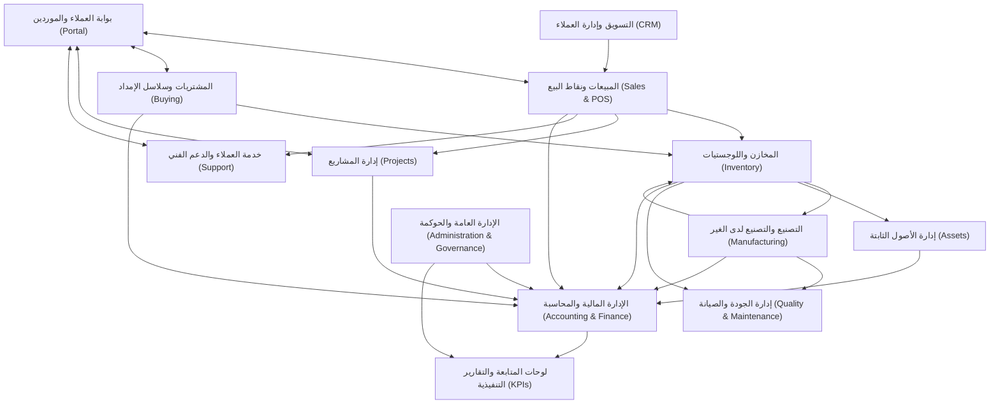

# الدليل التعريفي الشامل لنظام إدارة موارد المؤسسة (ERPNext)

## نظرة تنفيذية عامة

يمثّل النظام منصة متكاملة لإدارة موارد المؤسسة (**ERP**)، صُمِّم لربط كافة إدارات الشركة وعملياتها التشغيلية والمالية في بيئة عمل واحدة موحدة، بدلاً من الاعتماد على أنظمة منفصلة أو جداول بيانات متفرقة. يوفّر النظام رؤية لحظية وشاملة لأداء الشركة عبر مختلف الفروع والشركات والعملات، مع إحكام الرقابة الداخلية وتسريع دورة اتخاذ القرار.

### القطاعات التي يدعمها النظام
يتكيّف النظام بمرونة عالية مع طبيعة نشاط الشركة عبر أربعة قطاعات رئيسية:
- **التجارة والتوزيع (`Distribution`):** إدارة سلاسل الإمداد، التسعير المتعدد، المبيعات بالجملة، والمستودعات.
- **التصنيع (`Manufacturing`):** تخطيط الإنتاج، قوائم المواد، أوامر التشغيل، وتتبع التكلفة الفعلية للمنتج.
- **التجزئة (`Retail`):** نقاط البيع السريعة، إدارة الورديات، العروض الترويجية، وبرامج ولاء العملاء.
- **الخدمات (`Services`):** إدارة المشاريع، تتبع ساعات العمل، العقود، وفوترة الخدمات.

### خريطة ترابط أقسام الشركة داخل النظام

---

## خريطة أقسام ووحدات النظام (نظرة سريعة)

| # | القسم / الوحدة | الهدف التجاري الرئيسي | أبرز المخرجات للعميل |
| :-: | :--- | :--- | :--- |
| 1 | **الإدارة المالية والمحاسبة (`Accounting & Finance`)** | ضبط التدفقات النقدية والرقابة المالية والامتثال الضريبي | قيود آلية، مطابقة بنكية ذكية، ميزانيات، وقوائم مالية وفق معايير `IFRS` |
| 2 | **المبيعات ونقاط البيع (`Sales & POS`)** | تعظيم الإيرادات وتسريع دورة البيع والتحصيل | عروض أسعار، أوامر بيع، تسعير مرن، نقاط بيع متكاملة، وعمولات |
| 3 | **إدارة علاقات العملاء والتسويق (`CRM`)** | بناء قمع مبيعات منظم ورفع معدل تحويل العملاء | متابعة الفرص البيعية، الحملات التسويقية، العقود، وسجل المكالمات |
| 4 | **المشتريات وسلاسل الإمداد (`Buying & Procurement`)** | تأمين الاحتياجات بأفضل سعر وجودة وفي الوقت المناسب | طلبات وعروض أسعار الموردين، أوامر الشراء، وتقييم أداء الموردين |
| 5 | **المخازن واللوجستيات (`Inventory & Warehousing`)** | ضبط الأرصدة والتكاليف وتقليل الهدر ونفاد المخزون | تتبع الأرقام التسلسلية والصلاحية، حجز المخزون، والشحن والتوصيل |
| 6 | **التصنيع والإنتاج والتصنيع لدى الغير (`Manufacturing & Subcontracting`)** | تخطيط السعة الإنتاجية وضبط تكلفة التصنيع وجودته | قوائم المواد، الجدولة الذكية، أوامر التشغيل، وأرضية المصنع |
| 7 | **إدارة المشاريع (`Projects`)** | تسليم المشاريع في الوقت والميزانية المحددين | تخطيط المهام، ساعات العمل، متابعة التكلفة والربحية لكل مشروع |
| 8 | **إدارة الأصول الثابتة (`Asset Management`)** | تعظيم العمر الإنتاجي للأصول وضبط إهلاكها وصيانتها | سجل أصول مركزي، إهلاك تلقائي، وتتبع النقل والصيانة والإصلاح |
| 9 | **إدارة الجودة والصيانة (`Quality & Maintenance`)** | ضمان مطابقة المنتجات والمعايير واستدامة خدمة ما بعد البيع | فحص الجودة، معالجة عدم المطابقة، وجداول الصيانة الدورية |
| 10 | **خدمة العملاء والدعم الفني (`Customer Support`)** | رفع رضا العملاء والالتزام بمستويات الخدمة المتفق عليها | تذاكر الدعم، تتبع اتفاقيات مستوى الخدمة (`SLA`)، ومطالبات الضمان |
| 11 | **بوابة العملاء والموردين (`Customer & Supplier Portal`)** | تقديم تجربة خدمة ذاتية احترافية لشركاء العمل | متابعة الطلبات والفواتير والشحنات وعروض الأسعار إلكترونياً |
| 12 | **الإدارة العامة والحوكمة والأتمتة (`Administration & Governance`)** | توحيد السياسات والصلاحيات وتقليل العمل اليدوي المتكرر | هيكل متعدد الشركات، اعتمادات إدارية، وتقارير وأتمتة دورية |

---

## تفصيل أقسام ووحدات النظام من منظور الأعمال

### 1. الإدارة المالية والمحاسبة (`Accounting & Finance`)

**دور القسم في الشركة:**  
يمثّل القلب المالي للمؤسسة؛ حيث تتجمع فيه آثار كل العمليات التجارية والتشغيلية لحظياً في شكل قيود محاسبية منضبطة، مع إدارة كاملة للخزينة والبنوك والضرائب والميزانيات.

**أهم العمليات والوظائف:**
- **الهيكل المحاسبي والأبعاد التحليلية:** شجرة حسابات شجرية مرنة، دفاتر مالية متعددة، مراكز تكلفة وتوزيعاتها، وأبعاد محاسبية مخصصة (مثل الفروع أو خطوط الإنتاج أو المشاريع) لقياس ربحية كل قطاع بدقة.
- **الفوترة والذمم (العملاء والموردون):** إدارة فواتير المبيعات والمشتريات، الإشعارات الدائنة والمدينة، جداول السداد والدفعات المقدمة، تسوية المدفوعات مع الفواتير، ورسائل المطالبة بالمتأخرات (`Dunning`) وخصم الفواتير.
- **البنوك والخزينة والمطابقة الذكية:** إدارة الحسابات البنكية وخطابات الضمان والشيكات، استيراد كشوف الحساب البنكية (بما في ذلك استخراج الكشوف من ملفات `PDF` وصيغ البنوك القياسية)، الربط البنكي الآلي (عبر تكامل `Plaid`)، وأداة المطابقة البنكية التفاعلية بقواعد مطابقة تلقائية.
- **الضرائب والامتثال الإقليمي:** قواعد وقوالب ضريبة القيمة المضافة (`VAT`) وضريبة الخصم من المنبع، الفوترة الإلكترونية، ودعم المتطلبات الضريبية الإقليمية (مثل إقرارات ضريبة القيمة المضافة في الإمارات والسعودية وإيطاليا والولايات المتحدة وجنوب أفريقيا).
- **الميزانيات والاشتراكات والمساهمين:** إعداد الميزانيات التقديرية والرقابة على الصرف، معالجة الإيرادات والمصروفات المؤجلة، إدارة خطط الاشتراكات والفوترة الدورية، وسجل المساهمين وتحويلات الأسهم، وإقفال الفترات المالية والسنوات المالية.

**أبرز التقارير ومؤشرات الأداء:**
- القوائم المالية المعتمدة وفق معايير `IFRS` (الميزانية العمومية، قائمة الدخل، قائمة التدفقات النقدية، ميزان المراجعة، والقوائم المجمعة لعدة شركات).
- تقارير أعمار الديون للعملاء والموردين، دفتر الأستاذ العام، تحليل الربحية وإجمالي الربح، تقارير مقارنة الميزانية بالفعلي، النسب المالية، سجل المبيعات والمشتريات، وتقارير الإقرارات الضريبية ومطابقة البنوك.

---

### 2. المبيعات ونقاط البيع (`Sales & POS`)

**دور القسم في الشركة:**  
ينظّم كل مراحل البيع من تسعير المنتجات وخدمة العملاء حتى إتمام الصفقات وإدارة فروع التجزئة، مع ربط مباشر بالمخزون والائتمان والعمولات.

**أهم العمليات والوظائف:**
- **إدارة العملاء والائتمان:** ملفات تفصيلية للعملاء ومجموعاتهم ومناطقهم الجغرافية، وتحديد الحدود الائتمانية لكل عميل ومنع التجاوز عند إصدار الطلبات أو الفواتير.
- **دورة البيع الكاملة:** إصدار عروض الأسعار وتتبع صلاحيتها وأسباب خسارتها، الفواتير المبدئية، أوامر البيع، جداول التسليم، ومذكرات التركيب لدى العميل.
- **التسعير والعروض والولاء:** قوائم أسعار متعددة حسب العملة أو فئة العميل، قواعد تسعير وخصومات مرنة، حملات ترويجية وكوبونات خصم، حزم المنتجات المجمعة (`Product Bundles`)، وبرامج نقاط ولاء العملاء.
- **نظام نقاط البيع (`POS`):** واجهة بيع سريعة للفروع والمتاجر تدعم تعدد وسائل الدفع، فتح وإغلاق ورديات الكاشير، ومراجعة وجرد النقدية في نهاية الوردية.
- **فريق البيع والعمولات:** إدارة مندوبي المبيعات وشركاء البيع، تحديد مستهدفات البيع، واحتساب العمولات تلقائياً.

**أبرز التقارير ومؤشرات الأداء:**
- تحليلات المبيعات واتجاهات أوامر البيع وعروض الأسعار، قمع المبيعات (`Sales Funnel`)، ومعدلات فقدان العروض.
- تقارير أرصدة ائتمان العملاء، العملاء الخاملين، ولاء واكتساب العملاء، سجل نقاط البيع (`POS Register`)، وتقارير تحقيق المستهدفات وعمولات المندوبين والمناطق.

---

### 3. إدارة علاقات العملاء والتسويق (`CRM`)

**دور القسم في الشركة:**  
يركّز على مرحلة ما قبل البيع وبناء العلاقة مع العميل؛ لضمان متابعة كل عميل محتمل دون إغفال، وتحويل الاهتمام إلى عقود وصفقات فعلية.

**أهم العمليات والوظائف:**
- **إدارة الفرص وقمع المبيعات:** تسجيل العملاء المحتملين (`Leads`) والعملاء المرتقبين، تحويلهم إلى فرص بيعية (`Opportunities`)، ومتابعتهم عبر مراحل البيع المختلفة مع توثيق أسباب خسارة الفرص.
- **التسويق والحملات:** تخطيط الحملات التسويقية، جدولة حملات البريد الإلكتروني، تقسيم قطاعات السوق، وتوثيق بيانات المنافسين.
- **العقود والمواعيد:** إنشاء العقود من قوالب معتمدة ومتابعة بنود التنفيذ وحالة السريان، وإدارة حجز المواعيد للعملاء وفق فترات التوافر.
- **التواصل والمكالمات الهاتفية:** تعريف قنوات التواصل وأوقات العمل، وتسجيل المكالمات الهاتفية الواردة والصادرة وربطها تلقائياً بسجل العميل لتوحيد سجل التواصل.

**أبرز التقارير ومؤشرات الأداء:**
- تحليلات خط المبيعات (`Sales Pipeline Analytics`)، ملخص الفرص حسب المرحلة البيعية، وكفاءة الحملات التسويقية.
- تقارير زمن الاستجابة الأولى للفرص، زمن تحويل العميل المحتمل، كفاءة مسؤولي المبيعات، والفرص المفقودة.

---

### 4. المشتريات وسلاسل الإمداد (`Buying & Procurement`)

**دور القسم في الشركة:**  
يضمن توفير احتياجات الشركة من المواد الخام والبضائع والخدمات بأفضل شروط تجارية وجودة توريد ممكنة، مع رقابة كاملة على دورة الاعتماد والاستلام.

**أهم العمليات والوظائف:**
- **إدارة الموردين وتقييمهم:** قاعدة بيانات الموردين ومجموعاتهم وشروط التعامل، ونظام تقييم أداء الموردين (`Supplier Scorecard`) لقياس الالتزام بالمواعيد والجودة والأسعار بشكل دوري.
- **طرح المناقصات وطلبات الأسعار:** تحويل طلبات الاحتياج إلى طلبات عروض أسعار (`RFQ`) تُرسل لعدة موردين، وتسجيل ومقارنة عروض أسعار الموردين لاختيار العرض الأنسب.
- **أوامر الشراء ومتابعة التوريد:** إصدار أوامر الشراء المعتمدة، ربطها بالميزانية التقديرية، ومتابعة ما تم توريده وفوترته من كل أمر.

**أبرز التقارير ومؤشرات الأداء:**
- متتبع المشتريات (`Procurement Tracker`)، مقارنة عروض أسعار الموردين، وتحليلات واتجاهات أوامر الشراء.
- تقارير الطلبات المطلوب شراؤها أو استلامها، سجل تاريخ شراء الأصناف، وتقارير متابعة التوريدات.

---

### 5. المخازن واللوجستيات (`Inventory & Warehousing`)

**دور القسم في الشركة:**  
يحافظ على دقة الأرصدة وتكاليف البضاعة في جميع المستودعات، ويمنع العجز أو التكدس عبر تتبع شامل لكل حركة دخول أو خروج أو تحويل.

**أهم العمليات والوظائف:**
- **المستودعات والأصناف:** هيكلة شجرية للمستودعات ومناطق التخزين وسعاتها وقواعد التسكين (`Putaway Rules`)، وإدارة الأصناف بمتغيراتها (المقاسات/الألوان)، والبدائل، والباركود، ووحدات القياس.
- **الحركات المخزنية والتجهيز:** طلبات المواد، الاستلام من الموردين، الصرف والتحويل بين المستودعات، قوائم السحب والتجهيز (`Pick List`)، التعبئة، وحجز المخزون لطلبات محددة (`Stock Reservation`).
- **التتبع الدقيق (السيريال والتشغيلات):** تتبع الأصناف بالأرقام التسلسلية (`Serial No`) أو أرقام التشغيلات وتواريخ الصلاحية (`Batch`) لضمان قابلية التتبع الكاملة.
- **الجرد المستمر وتكاليف الاستيراد:** الربط المحاسبي اللحظي لحركات المخزون (`Perpetual Inventory`)، الجرد والتسوية، وإضافة مصاريف الشحن والجمارك والتأمين على تكلفة الصنف (`Landed Cost`).
- **الشحن وإعادة الطلب التلقائي:** إدارة الشحنات والطرود ورحلات التوصيل، مع إعادة طلب المخزون تلقائياً عند وصوله لحد إعادة الطلب.

**أبرز التقارير ومؤشرات الأداء:**
- أرصدة المخازن وحركة دفتر المخزون، التوقعات الكمية للمخزون، أعمار المخزون، وحالات انتهاء صلاحية التشغيلات والضمان.
- تقارير النواقص والكميات المحجوزة، سعة المستودعات، تكاليف الاستيراد، ومقارنة قيمة المخزون الدفترية بالرصيد المحاسبي.

---

### 6. التصنيع والإنتاج والتصنيع لدى الغير (`Manufacturing & Subcontracting`)

**دور القسم في الشركة:**  
يدير العملية الإنتاجية من لحظة التخطيط وتقدير الاحتياجات حتى خروج المنتج التام بأعلى كفاءة، مع حساب التكلفة الفعلية واستغلال السعة الإنتاجية للمصنع.

**أهم العمليات والوظائف:**
- **هندسة المنتج والمصنع:** إنشاء قوائم المواد (`BOM`) متعددة المستويات، مسارات التصنيع والعمليات، محطات العمل وسعتها وتكاليف تشغيلها، والتصميم المرئي لأرضية المصنع (`Visual Plant Floor`).
- **التخطيط الذكي وجدولة الإنتاج:** التنبؤ بالمبيعات، الخطة الرئيسية للإنتاج (`MPS`)، خطة الإنتاج وحساب احتياجات المواد (`MRP`)، ومحرك جدولة السعة الإنتاجية الذي يدعم الجدولة الأمامية والعكسية واختبار سيناريوهات التخطيط قبل اعتمادها.
- **التنفيذ والمتابعة في أرضية المصنع:** أوامر التشغيل (`Work Orders`)، بطاقات العمل (`Job Cards`)، واجهة أرضية المصنع (`Shop Floor`) لتسجيل الإنتاج والأوقات، وتسجيل الأعطال وتوقفات الآلات.
- **التصنيع لدى ولصالح الغير (`Subcontracting`):** إدارة إرسال الخامات لمصنّعين خارجيين واستلام المنتجات الجاهزة منهم، وكذلك التصنيع الداخلي لصالح الغير.

**أبرز التقارير ومؤشرات الأداء:**
- تقارير تخطيط الإنتاج واحتياجات المواد (`MRP`)، مستكشف وتباين قوائم المواد (`BOM Variance`)، ومقارنة قوائم المواد.
- ملخص أوامر التشغيل قيد التنفيذ والمكتملة، استهلاك المواد الخام، كفاءة بطاقات العمل، تحليل الأعطال، والفاقد وتكلفة ضعف الجودة.

---

### 7. إدارة المشاريع (`Projects`)

**دور القسم في الشركة:**  
يمكّن شركات الخدمات والمقاولات والمشاريع الداخلية من تسليم مشاريعها في الموعد المحدد وضمن الميزانية، مع وضوح كامل للتكلفة والربحية.

**أهم العمليات والوظائف:**
- **هيكلة المشاريع والمهام:** إنشاء المشاريع من قوالب جاهزة، تقسيم العمل إلى مهام ومراحل مع تحديد الاعتماديات بين المهام، وإرسال تحديثات دورية لحالة المشروع.
- **تتبع الوقت والتكلفة والفوترة:** تسجيل ساعات العمل الفعلية للموظفين (`Timesheets`) وربطها بنوع النشاط وتكلفته، وفوترة العميل بناءً على الساعات أو مراحل الإنجاز.
- **لوحات متابعة المشروع:** عرض مرئي شامل لحالة المشروع وتقدم المهام وتوزيع الفريق، إلى جانب متابعة تفصيلية لتكاليف المشروع مقابل الميزانية والربحية.

**أبرز التقارير ومؤشرات الأداء:**
- ملخص المشاريع والمهام المتأخرة، ملخص ساعات العمل اليومية وفوترة الأوقات، وتتبع المخزون المصروف على مستوى كل مشروع.

---

### 8. إدارة الأصول الثابتة (`Asset Management`)

**دور القسم في الشركة:**  
يحافظ على قيمة أصول الشركة (المعدات، المركبات، الأجهزة، المباني) منذ شرائها أو رسملتها وحتى استبعادها، مع أتمتة كاملة للإهلاك والصيانة.

**أهم العمليات والوظائف:**
- **السجل المركزي والرسملة:** تصنيف الأصول وربطها بمواقعها وفروعها ومستخدميها، ورسملة الأصول المجمعة أو المنشأة داخلياً.
- **الإهلاك التلقائي وإعادة التقييم:** إنشاء جداول الإهلاك وترحيل قيود الإهلاك تلقائياً وبانتظام (مع دعم إهلاك الورديات للمعدات)، بالإضافة إلى تعديلات قيمة الأصول.
- **الحركة والصيانة والإصلاح:** تتبع نقل الأصول بين الفروع والمواقع، جدولة الصيانة الوقائية للأصول وتشكيل فرق الصيانة، وتسجيل عمليات الإصلاح وتكاليفها.

**أبرز التقارير ومؤشرات الأداء:**
- سجل الأصول الثابتة (`Fixed Asset Register`)، تقارير الإهلاكات والأرصدة الدفترية، وسجل حركات وأنشطة وصيانة الأصول.

---

### 9. إدارة الجودة والصيانة (`Quality & Maintenance`)

**دور القسم في الشركة:**  
يرفع موثوقية منتجات وخدمات الشركة عبر منظومة حوكمة جودة مستمرة، مقترنة بخدمة صيانة وقائية ودورية لما بعد البيع.

**أهم العمليات والوظائف:**
- **منظومة الجودة المؤسسية:** تحديد أهداف الجودة وإجراءات العمل القياسية، جدولة المراجعات الدورية واجتماعات الجودة، وجمع تقييمات وآراء العملاء.
- **ضبط جودة المواد والإنتاج:** إجراء فحص الجودة (`Quality Inspection`) بناءً على قوالب ومعايير محددة عند استلام المشتريات أو أثناء التصنيع أو قبل التسليم.
- **معالجة الحيود والتحسين:** تسجيل حالات عدم المطابقة (`Non Conformance`) وتنفيذ الإجراءات التصحيحية والوقائية.
- **صيانة ما بعد البيع:** إنشاء جداول الصيانة الدورية للمنتجات والأجهزة المباعة للعملاء وتوثيق زيارات الصيانة الميدانية.

**أبرز التقارير ومؤشرات الأداء:**
- تقارير مراجعات الجودة، ملخص فحوصات الجودة، وتقارير جداول الصيانة المستحقة والمنفذة.

---

### 10. خدمة العملاء والدعم الفني (`Customer Support`)

**دور القسم في الشركة:**  
يضمن استجابة سريعة ومنظمة لشكاوى واستفسارات العملاء، مع قياس التزام الفريق بمستويات الخدمة المتفق عليها.

**أهم العمليات والوظائف:**
- **إدارة التذاكر والشكاوى:** استقبال تذاكر الدعم الفني وتصنيفها حسب النوع والأولوية، وتتبع حالتها حتى الإغلاق.
- **اتفاقيات مستوى الخدمة (`SLA`):** تحديد أوقات الاستجابة والحل المستهدفة لكل شريحة عملاء أو أولوية، مع تنبيهات تلقائية عند الاقتراب من التأخير أو تجاوزه.
- **مطالبات الضمان:** تسجيل ومتابعة طلبات الضمان المرتبطة بالمنتجات المباعة والأرقام التسلسلية.

**أبرز التقارير ومؤشرات الأداء:**
- تقارير زمن الاستجابة الأولى للتذاكر، تحليلات وملخص تذاكر الدعم، وتوزيع ساعات الدعم الفني.

---

### 11. بوابة العملاء والموردين (`Customer & Supplier Portal`)

**دور القسم في الشركة:**  
يوفّر واجهة إلكترونية مباشرة للشركاء الخارجيين لتعزيز الشفافية وتخفيف العبء الإداري عن فرق المبيعات والمشتريات والدعم.

**أهم العمليات والوظائف:**
- **بوابة العملاء:** تمكين العميل من استعراض عروض الأسعار، طلبات البيع، الفواتير، الشحنات، المشاريع، تذاكر الدعم، العناوين، وساعات العمل المفوترة، إضافةً إلى حجز المواعيد إلكترونياً.
- **بوابة الموردين:** تمكين المورد من الاطلاع على طلبات عروض الأسعار (`RFQ`) وتقديم عروضه مباشرة، ومتابعة أوامر الشراء وفواتير المشتريات.

---

### 12. الإدارة العامة والحوكمة والأتمتة (`Administration & Governance`)

**دور القسم في الشركة:**  
يضبط البنية التنظيمية للمؤسسة وقواعد الرقابة الإدارية، ويؤتمت المهام الروتينية لتعمل الشركة بسلاسة وأمان.

**أهم العمليات والوظائف:**
- **الهيكل التنظيمي والتأسيس:** إدارة تعدد الشركات داخل نفس النظام، الفروع، الإدارات، المسميات الوظيفية، السجلات الأساسية للموظفين ومجموعاتهم، قوائم العطلات الرسمية، والسائقين والمركبات.
- **الحوكمة والتفويض:** تحديد قواعد التفويض وحدود الصلاحيات المالية للاعتمادات، وعزل بيانات الأصناف والعملاء والموردين على مستوى كل شركة.
- **الأتمتة والعمليات المجمّعة والتكامل:** إرسال ملخصات بريدية دورية للإدارة، تنفيذ وتحويل المستندات بأعداد كبيرة، أدوات استيراد البيانات المجمّعة (مثل استيراد العملاء والموردين بعناوينهم في ملف واحد)، ودعم معايير وأكواد تبادل البيانات الإلكتروني (`EDI`).

---

## كيف تعمل الأقسام معاً في يوم العمل الفعلي؟ (رحلات العمل المتكاملة)

1. **رحلة المبيعات والتحصيل (`Order-to-Cash`):**  
   تسجيل عميل محتمل وفرصة بيعية (`CRM`) ← إرسال عرض سعر وأمر بيع (`Sales`) ← تجهيز وصرف البضاعة من المستودع (`Inventory`) ← إصدار الفاتورة تلقائياً (`Accounting`) ← التحصيل والمطابقة البنكية الذكية (`Banking & Finance`).
2. **رحلة المشتريات والتوريد (`Procure-to-Pay`):**  
   رفع طلب احتياج مواد (`Inventory`) ← إرسال طلبات عروض أسعار ومقارنة الموردين (`Buying`) ← إصدار أمر الشراء واستلام البضاعة وفحص جودتها (`Inventory & Quality`) ← تسجيل فاتورة المورد وتحميل مصاريف الشحن والجمارك (`Accounting`) ← السداد وتقييم المورد.
3. **رحلة التصنيع والإنتاج (`Plan-to-Produce`):**  
   التنبؤ بالطلب وإعداد خطة الإنتاج وجدولة الماكينات (`Manufacturing`) ← صرف الخامات من المستودع أو إرسالها لمصنّع خارجي (`Inventory & Subcontracting`) ← تنفيذ أوامر التشغيل وتسجيل الوقت والأعطال (`Shop Floor`) ← إدخال المنتج التام بتكلفته الفعلية إلى المستودع والمحاسبة.
4. **رحلة المشاريع والخدمات (`Project-to-Cash`):**  
   إنشاء المشروع من قالب وتوزيع المهام (`Projects`) ← تسجيل ساعات العمل والمصروفات المباشرة على المشروع ← متابعة التقدم والميزانية والربحية لحظياً ← إصدار الفواتير للعميل وتحصيلها (`Accounting`).
5. **رحلة ما بعد البيع والجودة (`Support & Quality`):**  
   استقبال شكوى العميل أو طلب الضمان (`Support`) ← متابعة الالتزام باتفاقية مستوى الخدمة (`SLA`) ← جدولة زيارة صيانة ميدانية (`Maintenance`) ← توثيق حالة عدم المطابقة والإجراء التصحيحي لمنع التكرار (`Quality`).

---

## القيمة المضافة ومزايا النظام للعميل (لماذا هذا النظام؟)

- **منصة واحدة تغني عن تشتت الأنظمة:** توحيد المبيعات، المشتريات، المخازن، التصنيع، المشاريع، والمالية في قاعدة بيانات واحدة دون الحاجة لإعادة إدخال البيانات أو الاعتماد على ملفات إكسل متفرقة.
- **ربط لحظي بين التشغيل والمالية:** كل حركة بيع أو شراء أو تصنيع أو صرف مخزني تنعكس فوراً في الحسابات والتقارير المالية ومراكز التكلفة.
- **رقابة وحوكمة قوية:** حدود ائتمان، موافقات إدارية ومالية حسب الصلاحيات، رقابة على الميزانيات التقديرية، وتدقيق كامل لكل تعديل أو حركة في النظام.
- **جاهز للنمو والتوسع:** يدعم تعدد الشركات والفروع والمستودعات والعملات، مع قابلية التخصيص لمختلف قطاعات التجارة والصناعة والخدمات.
- **أتمتة تقلل الأخطاء والجهد اليدوي:** ترحيل الإهلاك تلقائياً، إعادة طلب المخزون عند النقص، تنبيهات تأخر الدعم الفني، ومطابقة بنكية مؤتمتة.
- **رؤية تنفيذية فورية وتجربة رقمية للعملاء:** تقارير وتحليلات لحظية للإدارة العليا، مع بوابة إلكترونية احترافية تخدم العملاء والموردين على مدار الساعة.
